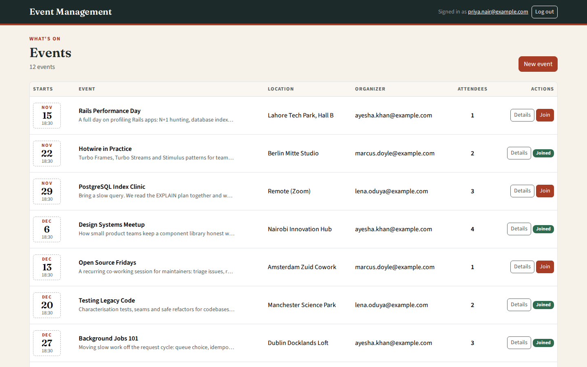
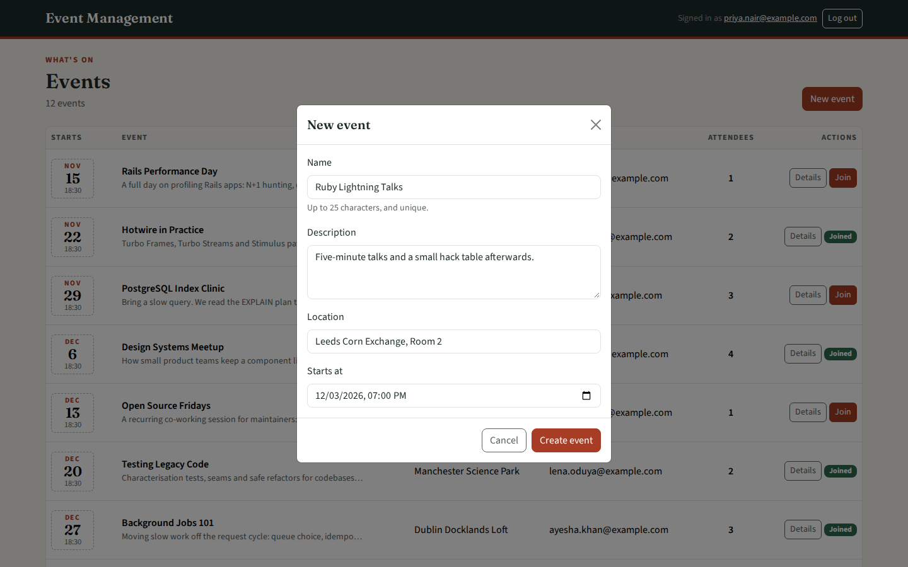
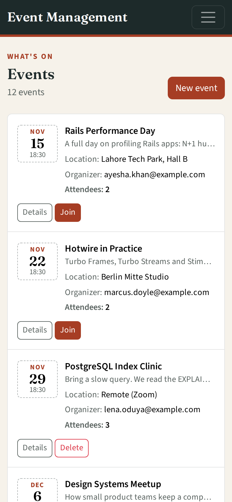
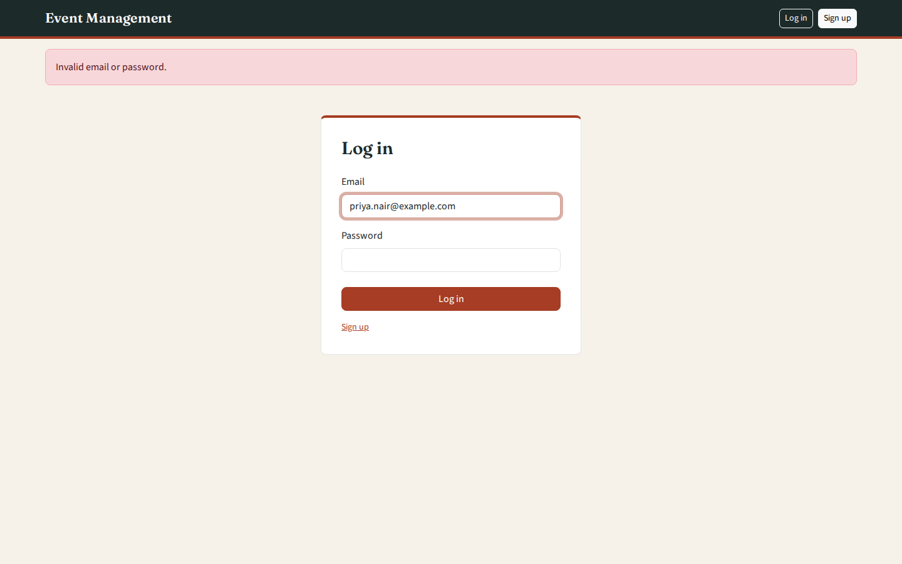
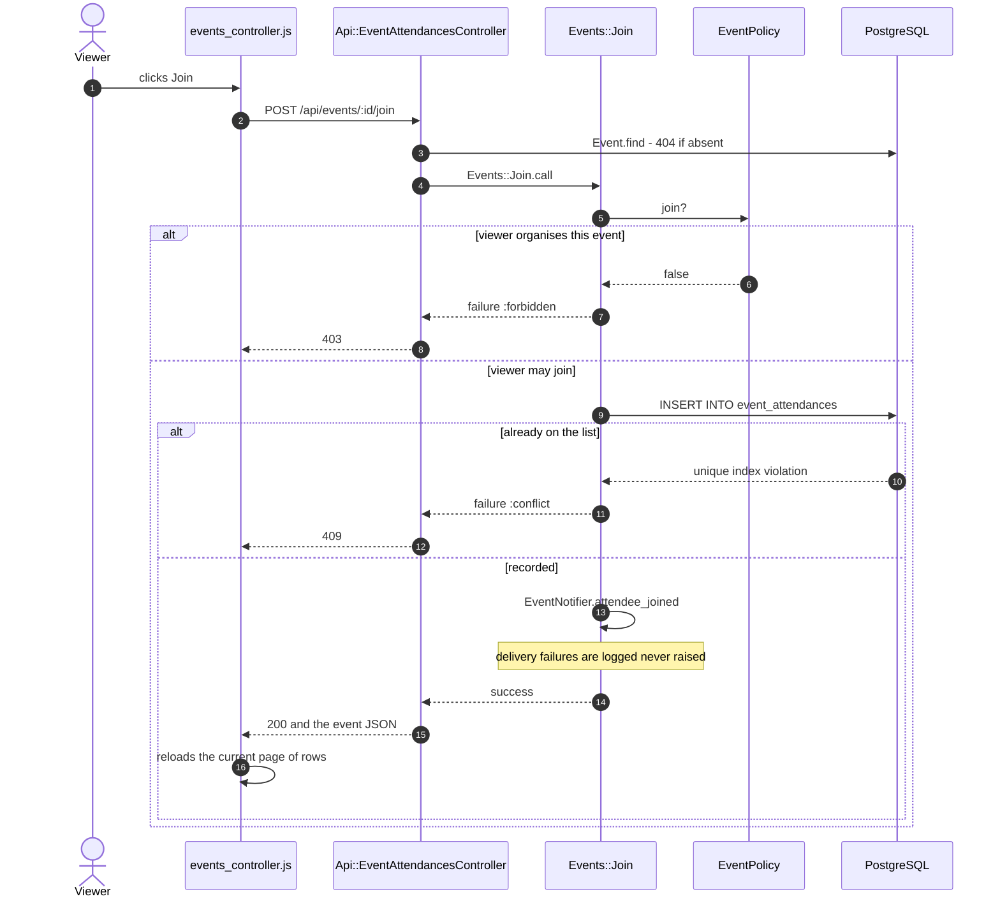

# Event Management App

A Rails 8 monolith where signed-in people publish events and join each other's.
One server-rendered page does the whole job: Devise owns the accounts, an ERB
template renders the shell, and a Stimulus controller keeps the events board
fresh by calling this same application's JSON API under `/api`. PostgreSQL
underneath.

No calendar sync, no payments, no email. What is actually interesting here is
narrow: who may change what, what a list endpoint has to do before it is safe to
paginate, and getting a start time from a browser to the database without
shifting it by the viewer's UTC offset.

## This is not the API + React pair

Two neighbouring repositories share most of the name and none of the code.
`event_management_app_BE` is an API-only Rails service with bearer-token auth;
`event_management_FE` is its React client. This repo is a single Rails
application: session cookies instead of JWTs, Hotwire and importmaps instead of
a bundled SPA, `event_attendances` instead of `event_users`.

The data model is, admittedly, the one anybody would draw for this problem:
`users`, `events` carrying an `organizer_id`, and a join table unique on
`(event_id, attendee_id)`. The sibling API's README already contains that ER
diagram; redrawing it here would say nothing new, so `db/schema.rb` is the
reference.

## What it looks like



Signed in as an attendee who organises none of the first rows, so each offers
Details plus either Join or a "Joined" badge. Each start time is drawn as a
ticket stub in the viewer's own time zone. Ten rows to a page, twelve events
seeded.


The details modal: description, start time, location, organizer and the attendee
count, all from `GET /api/events/:id`.



Creating an event. The name is capped at 25 characters and must be unique; on a
422 the per-field messages render inside this modal rather than reloading.


Immediately after joining: the toast, the top row flipped to "Joined", and its
attendee count up by one, with no page reload.



Below the `md` breakpoint each table row becomes a card, so a 390px screen needs
no sideways scrolling.



A wrong password says so. (It used to re-show the empty form: the layout never
rendered the flash.)

The desktop shots are 1440x900 and the phone shot 390x844, taken with Playwright
against a database filled by `bin/rails db:seed`. Every person and event in them
is seed data.

## Joining an event

Join is the only operation in the app with more than one step, so it is the one
piece worth a diagram. Three outcomes matter: you organise it (403), you already
joined (409), or it works (200).



`Events::Join` returns an `ApplicationService::Result` rather than raising, so an
expected failure is a status code and not a 500. Duplicates are caught twice
(the model validation for the ordinary case, a rescue of
`ActiveRecord::RecordNotUnique` for the race the index catches) and both land on
409.

`EventNotifier` is the seam for "tell the organizer a seat went". It is a
named-adapter registry: register anything that responds to
`attendee_joined(event:, attendee:)` and select it with `EVENT_NOTIFIER`. Ships
with `:log` and `:noop`. Delivery is wrapped so a broken webhook cannot fail the
join; `spec/notifiers/event_notifier_spec.rb` has a test for exactly that.

## Where the rules live

`EventPolicy` answers every permission question (`show?`, `update?`, `destroy?`,
`join?`) and nothing else re-derives them. The API controllers call it from a
`before_action`; `EventSerializer#editable` calls the same object to decide
whether a row gets a Delete button, so the actions the page offers and the rules
the server enforces cannot drift apart. Ownership itself comes from the session
only: `event_params` does not permit `organizer`, and a request spec asserts a
forged `organizer_id` in the body is ignored.

## Start times and time zones

`events.date` is a `datetime` stored in UTC. The create form uses
`<input type="datetime-local">`, which yields wall-clock time with no zone, so the
Stimulus controller converts it with `toISOString()` before posting. 18:30 typed
in Karachi (UTC+5) is sent as `13:30Z`, and the board formats it back to 18:30 for
that viewer and to 13:30 for someone in London. The API always answers with ISO
8601 including the offset; a request spec pins that an offset in the request
survives, and the Playwright run behind the screenshots checks the round trip in
a UTC+5 browser.

## Why the list endpoint is shaped the way it is

Each row of the events table needs three things beyond the event itself: the
organizer, the attendee count, and whether you have joined. Asked naively that is
a query per row per fact.

- `Event.for_listing` preloads organizers and computes the counts in the same
  statement via a grouped `LEFT JOIN` (`with_attendee_counts`).
- `Viewer` loads the signed-in user's attended event ids once per request into a
  `Set`, and is handed to the serializers as their scope, so `joined` is a set
  membership test rather than a query.
- `spec/requests/api/events_spec.rb` ("does not go back to the database once per
  row") counts real `sql.active_record` notifications for a ten-row page and
  asserts no more than six. It fails if the N+1 returns.

Page size is clamped server-side: `Pagination` defaults to 10 and caps `per_page`
at `EVENTS_MAX_PAGE_SIZE` (100), so `per_page=1000000` is not a way to ask for the
whole catalogue. A misconfigured cap (0, or not a number) falls back to one row
rather than failing every request, and `page` is capped at 100,000 so the OFFSET
always fits in a bigint.

The original `event_attendances` migration
(`db/migrate/20231207155433_create_event_attendances.rb`, still in the tree)
declares both references with `index: false` and no foreign keys at all, leaving
"which events has this user joined?" with no usable index, since the one index
leads with `event_id`. `20260925000001` adds the `attendee_id` index, an index on
`events.date` for the chronological sort, and both foreign keys with
`ON DELETE CASCADE`.

## Run it

### With Docker Compose

Needs only Docker. The stack is PostgreSQL 16 plus the production image built
from the `Dockerfile`.

```sh
export SECRET_KEY_BASE=$(openssl rand -hex 64)
docker compose up --build
```

Open http://localhost:3000 (set `WEB_PORT` to publish elsewhere). On the first
boot `db:prepare` creates the schema and runs `db/seeds.rb`, which prints the
account to sign in with: `ayesha.khan@example.com`, password `SEED_PASSWORD`
(`password123` unless you export something else). Because those accounts have a
known password, treat this stack as a local demo, not a deployment.
`docker compose down -v` removes the database volume.

The `Dockerfile` has three stages: Node 22 compiles the Bootstrap stylesheet, a
Ruby 3.4 stage installs gems and precompiles assets, and the runtime stage is
`ruby:3.4.12-slim` with neither a compiler nor Node, running Puma as a non-root
user with a `HEALTHCHECK` on `/health`.

The steps the image performs (stylesheet build, `assets:precompile`,
`db:prepare` with seeding, Puma in production mode, the API calls below) have
been run in containers; a complete `docker compose build` has not, because
registry downloads were too slow where this was last checked.

### On your machine

Ruby 3.4.12 (`.ruby-version`), Node 22 (`.nvmrc`) with Yarn 1 for the
stylesheet build, and a PostgreSQL server.

```sh
bundle install
yarn install && yarn build:css

cp .env.example .env          # then export the values, or set them in your shell
bin/rails db:prepare          # creates, loads the schema and seeds a new database
bin/rails server              # http://localhost:3000
```

Rails does not read `.env` by itself; the file lists every variable the app
reads. `bin/dev` runs the server and the stylesheet watcher together through
foreman. `yarn build:css` is not optional on a fresh clone:
`app/assets/builds/application.css` is gitignored.

## Tests and lint

```sh
bundle exec rspec           # 105 examples
bundle exec rubocop         # rubocop with the rails, rspec, rspec_rails and factory_bot plugins
```

The suite needs a reachable PostgreSQL (the `DATABASE_*` variables) and runs
against `TEST_DATABASE_NAME`; create it once with
`RAILS_ENV=test bin/rails db:create db:schema:load`. Request specs cover the API,
the HTML pages and Devise's login and sign-up errors; there are no browser
specs in the suite.

## The JSON API

Every endpoint except `/health` needs a signed-in session cookie and a CSRF token
on writes, and answers under a root key. There are no API tokens, so this is
usable from this app's own pages and not from a third-party client.

| Method | Path | Notes |
| --- | --- | --- |
| `GET` | `/api/events` | `?page=` and `?per_page=`. Returns `{"events": [...], "meta": {...}}`. |
| `GET` | `/api/events/:id` | `{"event": {...}}`, 404 if unknown. |
| `POST` | `/api/events` | 201, or 422 with per-field messages. Organizer comes from the session. |
| `PATCH`/`PUT` | `/api/events/:id` | Organizer only, 403 otherwise. |
| `DELETE` | `/api/events/:id` | Organizer only, 204 on success. |
| `POST` | `/api/events/:id/join` | 200, 409 if already joined, 403 if you organise it. |
| `GET` | `/health` | Unauthenticated. 200 when the database answers, 503 when it does not. |

### Examples

Captured from the app running in production mode against the seed data,
signed in as `priya.nair@example.com`. Bodies are trimmed only where marked.

`GET /api/events?per_page=2`

```jsonc
{
  "events": [
    {
      "id": 1,
      "name": "Rails Performance Day",
      "description": "A full day on profiling Rails apps: N+1 hunting, database indexes, caching layers and background jobs.",
      "location": "Lahore Tech Park, Hall B",
      "date": "2026-11-15T18:30:00Z",
      "attendees_count": 1,
      "editable": false,
      "joined": false,
      "organizer": { "id": 1, "email": "ayesha.khan@example.com" }
    },
    { "id": 2, "name": "Hotwire in Practice", "...": "trimmed", "joined": true }
  ],
  "meta": { "page": 1, "per_page": 2, "total_count": 12, "total_pages": 6 }
}
```

`POST /api/events` with a start time in UTC+5. The response is the same
instant in UTC:

```jsonc
// request
{ "event": { "name": "Ruby Lightning Talks", "description": "Five-minute talks.",
             "location": "Leeds Corn Exchange", "date": "2026-12-03T19:00:00+05:00" } }
// 201 Created
{
  "event": {
    "id": 13,
    "name": "Ruby Lightning Talks",
    "description": "Five-minute talks.",
    "location": "Leeds Corn Exchange",
    "date": "2026-12-03T14:00:00Z",
    "attendees_count": 0,
    "editable": true,
    "joined": false,
    "organizer": { "id": 5, "email": "priya.nair@example.com" }
  }
}
```

A taken name and a blank location give `422 Unprocessable Content` with
per-field messages:

```jsonc
{ "name": ["has already been taken"], "location": ["can't be blank"] }
```

The join outcomes, in order: first join, second join, joining your own event,
and deleting someone else's event:

```text
POST   /api/events/1/join   200  {"event": {"id": 1, ..., "attendees_count": 2, "joined": true}}
POST   /api/events/1/join   409  {"event_id": ["has already been taken"]}
POST   /api/events/13/join  403  {"base": ["You cannot join this event"]}
DELETE /api/events/1        403  {"error": "You are not allowed to do that"}
DELETE /api/events/13       204
GET    /api/events          401  {"error": "You need to sign in or sign up before continuing."}   (no session)
GET    /health              200  {"status": "ok", "database": "ok"}
```

## Settings

Everything comes from the environment; `config/database.yml` holds no literal
credential and there is no `credentials.yml.enc`. `.env.example` lists all of
them, standard Rails knobs included. These are the ones specific to this app:

| Name | Default | Purpose |
| --- | --- | --- |
| `SECRET_KEY_BASE` | none | **Required in production** (and by Compose). `bin/rails secret` or `openssl rand -hex 64`. |
| `EVENTS_MAX_PAGE_SIZE` | `100` | Hard cap on `per_page` for `GET /api/events`. |
| `EVENT_NOTIFIER` | `log` (`noop` under test) | Which `EventNotifier` adapter delivers join notifications. |
| `SEED_PASSWORD` | `password123` | Password given to the accounts in `db/seeds.rb`. |

The database is configured either by `DATABASE_URL`, which overrides everything
else, or by `DATABASE_HOST`, `DATABASE_PORT`, `DATABASE_USERNAME`,
`DATABASE_PASSWORD`, `DATABASE_NAME` and `TEST_DATABASE_NAME`. There is no
fallback password compiled in: leave `DATABASE_PASSWORD` unset and none is sent.

## Known gaps

- **Authorisation stops at "the organizer owns it."** No roles, no admin, no
  co-owners.
- **No capacity, waitlist, cancellation or un-joining.** There is no column for a
  seat count and no route that removes an attendance, so nothing can turn anyone
  away and nothing lets them leave.
- **No email.** Devise runs with `database_authenticatable`, `registerable` and
  `validatable` only, so there is no password reset and no confirmation mail.
  `EventNotifier` writes to the log by default; no real delivery adapter ships.
- **No search or filtering, and no editing from the page.** The list is
  chronological and paginated. `Event.upcoming` exists and is tested, but no
  endpoint exposes it, and `PATCH /api/events/:id` has no form.
- **Offset pagination**, which drifts if rows are inserted while someone pages
  through. Fine at this size; a keyset cursor is the fix.
- **No background jobs and no browser tests in the suite.** Notification
  delivery happens inside the request, and the UI flows are covered by request
  specs plus the Playwright run used for the screenshots, which is not part of
  `rspec`.
- **The stylesheet compiles the whole of Bootstrap**, with no purge step, and
  Bootstrap's JavaScript and the fonts load from public CDNs at runtime.
- **Production over plain HTTP.** `force_ssl` is off so the Compose demo works
  on `localhost`; put TLS in front and turn it on before exposing this.

## License

MIT, see [LICENSE](LICENSE).
