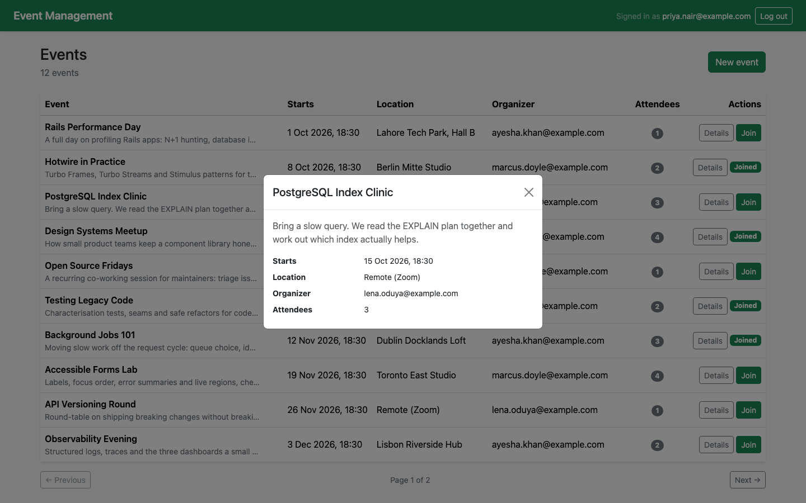
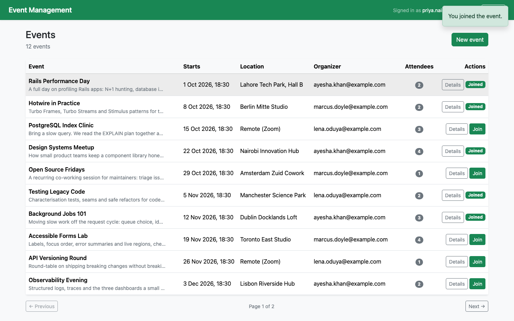
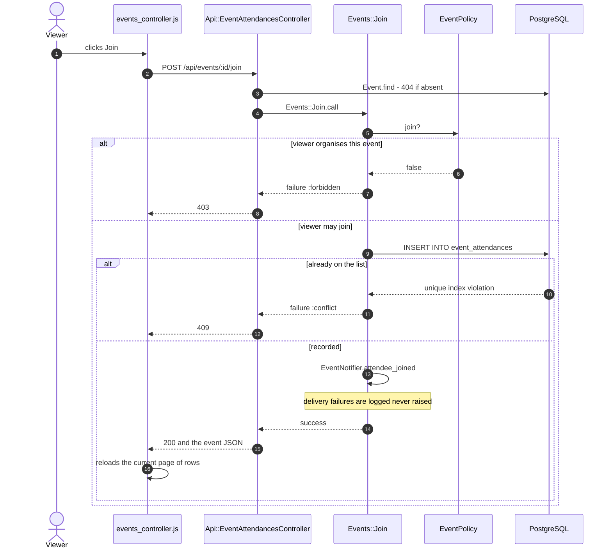

# Event Management App

A Rails 7 monolith where signed-in people publish events and join each other's.
One server-rendered page does the whole job: Devise owns the accounts, an ERB
template renders the shell, and a Stimulus controller keeps the events table
fresh by calling this same application's JSON API under `/api`. PostgreSQL
underneath.

No calendar sync, no payments, no email. What is actually interesting here is
narrow: who may change what, and what a list endpoint has to do before it is
safe to paginate.

## This is not the API + React pair

Two neighbouring repositories share most of the name and none of the code.
`event_management_app_BE` is an API-only Rails service with bearer-token auth;
`event_management_FE` is its React client. This repo is a single Rails
application — session cookies instead of JWTs, Hotwire and importmaps instead of
a bundled SPA, `event_attendances` instead of `event_users`.

The data model is, admittedly, the one anybody would draw for this problem:
`users`, `events` carrying an `organizer_id`, and a join table unique on
`(event_id, attendee_id)`. The sibling API's README already contains that ER
diagram; redrawing it here would say nothing new, so `db/schema.rb` is the
reference.

## What it looks like


Signed in as someone who organises none of these events, so every row offers
Details plus either Join or a "Joined" badge. Ten rows to a page, twelve events
seeded, hence page 1 of 2.



The details modal: description, start time, location, organizer and the attendee
count, all from `GET /api/events/:id`.


Creating an event. The name is capped at 25 characters and must be unique; on a
422 the per-field messages render inside this modal rather than reloading.



Immediately after joining: the toast, the top row flipped to "Joined", and its
attendee count up from 1 to 2 — no page reload.

All four are 1440x900, from a database populated by `bin/rails db:seed`.

## Joining an event

Join is the only operation in the app with more than one step, so it is the one
piece worth a diagram. Three outcomes matter: you organise it (403), you already
joined (409), or it works (200).



`Events::Join` returns an `ApplicationService::Result` rather than raising, so an
expected failure is a status code and not a 500. Duplicates are caught twice —
the model validation for the ordinary case, a rescue of
`ActiveRecord::RecordNotUnique` for the race the index catches — and both land on
409.

`EventNotifier` is the seam for "tell the organizer a seat went". It is a
named-adapter registry: register anything that responds to
`attendee_joined(event:, attendee:)` and select it with `EVENT_NOTIFIER`. Ships
with `:log` and `:noop`. Delivery is wrapped so a broken webhook cannot fail the
join — `spec/notifiers/event_notifier_spec.rb` has a test for exactly that.

## Where the rules live

`EventPolicy` answers every permission question — `show?`, `update?`, `destroy?`,
`join?` — and nothing else re-derives them. The API controllers call it from a
`before_action`; `EventSerializer#editable` calls the same object to decide
whether a row gets a Delete button, so the actions the page offers and the rules
the server enforces cannot drift apart. Ownership itself comes from the session
only: `event_params` does not permit `organizer`, and a request spec asserts a
forged `organizer_id` in the body is ignored.

## Why the list endpoint is shaped the way it is

Each row of the events table needs three things beyond the event itself: the
organizer, the attendee count, and whether you have joined. Asked naively that is
a query per row per fact.

- `Event.for_listing` preloads organizers and computes the counts in the same
  statement via a grouped `LEFT JOIN` (`with_attendee_counts`).
- `Viewer` loads the signed-in user's attended event ids once per request into a
  `Set`, and is handed to the serializers as their scope, so `joined` is a set
  membership test rather than a query.
- `spec/requests/api/events_spec.rb` — "does not go back to the database once per
  row" — counts real `sql.active_record` notifications for a ten-row page and
  asserts no more than six. It fails if the N+1 returns.

Page size is clamped server-side: `Pagination` defaults to 10 and caps `per_page`
at `EVENTS_MAX_PAGE_SIZE` (100), so `per_page=1000000` is not a way to ask for the
whole catalogue.

The original `event_attendances` migration
(`db/migrate/20231207155433_create_event_attendances.rb`, still in the tree)
declares both references with `index: false` and no foreign keys at all, leaving
"which events has this user joined?" with no usable index — the one index leads
with `event_id`. `20260925000001` adds the `attendee_id` index, an index on
`events.date` for the chronological sort, and both foreign keys with
`ON DELETE CASCADE`.

## Run it

Ruby 3.1.3 (`.ruby-version`), Node 20 for the stylesheet build, and a PostgreSQL
server — 16 is what it has been exercised against.

```sh
bundle install
yarn install && yarn build:css

cp .env.example .env          # point DATABASE_* at your local PostgreSQL
bin/rails db:create db:schema:load db:seed
bin/rails server              # http://localhost:3000
```

`bin/dev` runs the server and the stylesheet watcher together. `yarn build:css`
is not optional on a fresh clone: `app/assets/builds/application.css` is
gitignored. Seeding creates twelve events and prints the account to sign in with
— `ayesha.khan@example.com`, password `SEED_PASSWORD` (`password123` by default).

```sh
bundle exec rspec           # 94 examples
bundle exec rubocop         # rubocop + rubocop-rails + rubocop-rspec
```

The suite needs a reachable PostgreSQL and creates `TEST_DATABASE_NAME` on first
run.

A multi-stage `Dockerfile` (`ruby:3.1.3-slim`, non-root user, `HEALTHCHECK` on
`/health`) and a `docker-compose.yml` (`postgres:16-alpine` gated on a
`pg_isready` healthcheck, `db:prepare` on boot, `SECRET_KEY_BASE` required with
no default) are committed, but **neither the image build nor the container boot
has been run here** — treat that path as written-but-unverified.

## The JSON API

Every endpoint needs a signed-in session and answers under a root key. There are
no API tokens, so this is usable from this app's own pages and not from a
third-party client.

| Method | Path | Notes |
| --- | --- | --- |
| `GET` | `/api/events` | `?page=` and `?per_page=`. Returns `{"events": [...], "meta": {...}}`. |
| `GET` | `/api/events/:id` | `{"event": {...}}`, 404 if unknown. |
| `POST` | `/api/events` | 201, or 422 with per-field messages. Organizer comes from the session. |
| `PATCH`/`PUT` | `/api/events/:id` | Organizer only, 403 otherwise. |
| `DELETE` | `/api/events/:id` | Organizer only, 204 on success. |
| `POST` | `/api/events/:id/join` | 200, 409 if already joined, 403 if you organise it. |
| `GET` | `/health` | Unauthenticated. 200 when the database answers, 503 when it does not. |

`date` is a `datetime` and serialises as ISO 8601 with the time of day, not a
bare calendar day; the browser formats it in the viewer's locale and zone. Two
serializer specs pin that, the nil case included.

## Settings

Everything comes from the environment — `config/database.yml` holds no literal
credential. `.env.example` lists all of them, standard Rails knobs included;
below are the ones specific to this app.

| Name | Default | Purpose |
| --- | --- | --- |
| `SECRET_KEY_BASE` | — | **Required in production.** `bin/rails secret`. |
| `EVENTS_MAX_PAGE_SIZE` | `100` | Hard cap on `per_page` for `GET /api/events`. |
| `EVENT_NOTIFIER` | `log` (`noop` under test) | Which `EventNotifier` adapter delivers join notifications. |
| `SEED_PASSWORD` | `password123` | Password given to the accounts in `db/seeds.rb`. |

The database is configured either by `DATABASE_URL`, which overrides everything
else, or by `DATABASE_HOST`, `DATABASE_PORT`, `DATABASE_USERNAME`,
`DATABASE_PASSWORD`, `DATABASE_NAME` and `TEST_DATABASE_NAME`. There is no
fallback password compiled in: leave `DATABASE_PASSWORD` unset and none is sent.

## Known gaps

- **Authorisation stops at "the organizer owns it."** No roles, no admin, no
  co-owners.
- **No capacity, waitlist, cancellation or un-joining.** There is no column for a
  seat count and no route that removes an attendance, so nothing can turn anyone
  away and nothing lets them leave.
- **No email.** Devise runs with `database_authenticatable`, `registerable` and
  `validatable` only, so there is no password reset and no confirmation mail.
  `EventNotifier` writes to the log by default; no real delivery adapter ships.
- **No search or filtering.** The list is chronological and paginated, nothing
  more. `Event.upcoming` exists and is tested, but no endpoint exposes it.
- **Offset pagination**, which drifts if rows are inserted while someone pages
  through. Fine at this size; a keyset cursor is the fix.
- **`config/credentials.yml.enc` is committed without its `master.key`** and is
  therefore undecryptable. Nothing reads it — production secrets come from the
  environment — but it should be deleted or reissued rather than left lying
  there.
- **No background jobs and no system specs.** Notification delivery happens
  inside the request, and the UI flows are covered by request specs rather than a
  browser test — Capybara and selenium-webdriver are already in the `Gemfile`.
- **The stylesheet compiles the whole of Bootstrap plus bootstrap-icons**, with
  no purge step.
